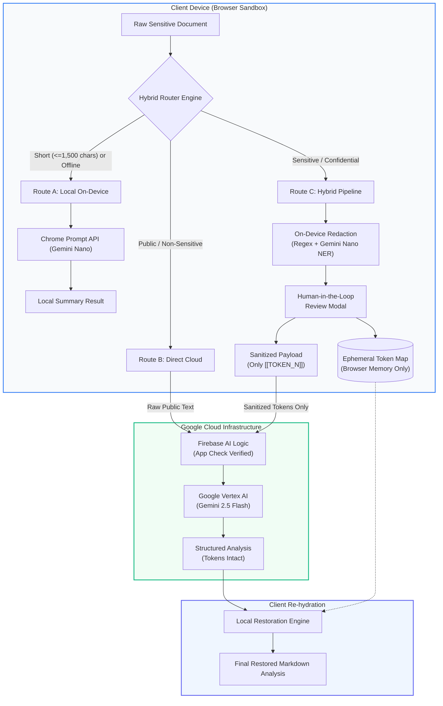
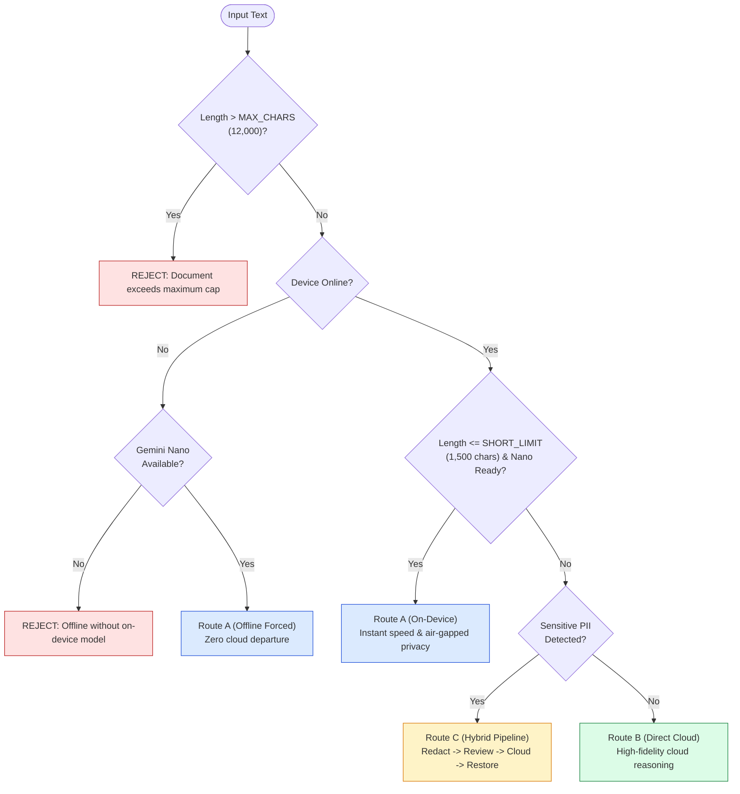
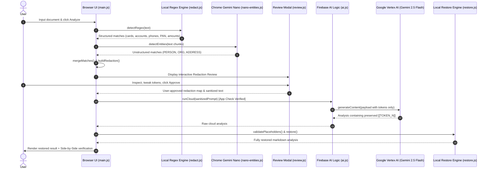

# Veil: System Architecture

**One-line pitch:** Use powerful cloud AI on documents you'd never paste into a chatbot.

---

## 1. System Overview & Philosophy

Modern enterprises and privacy-conscious users face a fundamental dilemma when analyzing sensitive documents (contracts, medical records, loan agreements, financial statements):
- **On-Device Models (e.g., Gemini Nano):** Offer complete data privacy and air-gapped execution, but have limited context windows and reduced reasoning depth on complex multi-page agreements.
- **Cloud Models (e.g., Gemini 2.5 Flash):** Offer state-of-the-art multi-page synthesis, legal reasoning, and risk detection, but require transmitting unencrypted confidential data over the network.

**Veil resolves this tension through a cooperative Hybrid Architecture:**
1. **On-Device Redaction:** The local browser environment identifies and sanitizes personal and proprietary data before any network transmission occurs.
2. **Opaque Cloud Reasoning:** Only anonymized text containing synthetic tokens (`[[PERSON_1]]`, `[[AMOUNT_1]]`) is dispatched to Google Vertex AI via Firebase AI Logic.
3. **Private In-Memory Restoration:** The cloud's structured analysis is received by the client and re-hydrated locally in browser memory.

The cloud model provides the reasoning; the edge hardware enforces the privacy.



---

## 2. Hybrid Routing Architecture

Veil routes documents dynamically based on length, detected sensitivity, local hardware capabilities, and network availability.



### Routing Decision Table

| Rule | Condition | Route | Operational Behavior |
|:---:|---|:---:|---|
| **1** | `length > MAX_CHARS (12,000)` | **REJECT** | Hard limit rejection. Prevents unbounded payload execution. |
| **2** | `!online && onDeviceAvailable` | **Route A** | Forced on-device execution. Emits advisory if `length > SHORT_LIMIT`. Zero network calls. |
| **3** | `!online && !onDeviceAvailable` | **REJECT** | Rejects with clear notice: offline and on-device model unavailable. |
| **4** | `length <= SHORT_LIMIT && onDeviceAvailable` | **Route A** | Pure on-device execution on Gemini Nano for instant response. |
| **5** | `sensitiveFound == true` | **Route C** | Hybrid pipeline: On-device NER + regex redaction, review gate, cloud call, local restore. |
| **6** | `sensitiveFound == false` | **Route B** | Direct cloud streaming via Firebase AI Logic. Bypasses redaction overhead for public text. |

*Note: The `SHORT_LIMIT` threshold defaults to 1,500 characters and is dynamically configurable in real time via **Firebase Remote Config**.*

---

## 3. Core Hybrid Pipeline (Route C)

Route C represents Veil’s flagship zero-leakage workflow, executed across four isolated stages:



### Stage 1: On-Device Redaction (Edge)
Redaction operates via a two-tier hybrid scanner:
1. **Deterministic Regex Engine:** Rapidly identifies structured, algorithmic patterns:
   - Payment card numbers (validated via client-side **Luhn algorithm** check).
   - Bank accounts, IFSC codes, PAN, Aadhaar, SSNs.
   - International & domestic phone numbers, email addresses.
   - Currency amounts (symbols, numeric amounts, and spelled-out currency text).
2. **On-Device Gemini Nano NER:** Handles unstructured contextual entities using Chrome’s built-in `window.ai.languageModel`:
   - People’s names (`PERSON`), organization names (`ORG`), and street/postal addresses (`ADDRESS`).
   - Text is processed in chunks of 3,500 characters.
   - Returned entities are verified strictly against the source text using exact substring offsets (`indexOf`). Hallucinations that do not match verbatim source text are discarded.

### Stage 2: Human-in-the-Loop Review Gate
- Prior to any cloud dispatch, Veil displays an interactive modal showing the document with all detected entities highlighted as token badges.
- Users can click any badge to un-redact false positives, or highlight text manually and click **"Hide Selected Text"** to mask additional secrets.
- An optional toggle allows users to unhide monetary amounts if cloud-side financial math is specifically required.
- **Invariable Guarantee:** Zero network calls are dispatched until the user explicitly clicks *"Approve & Send to Cloud AI"*.

### Stage 3: Sanitized Cloud Analysis (Firebase AI Logic)
- The approved redacted text replaces sensitive values with deterministic placeholders: `[[TYPE_INDEX]]` (e.g., `[[PERSON_1]]`, `[[AMOUNT_2]]`).
- System instructions enforce strict placeholder invariance:
  > *"Treat each placeholder like `[[PERSON_1]]` as an opaque token. Never guess, alter, or omit them. Copy placeholders EXACTLY as written."*
- Cloud inference is dispatched using **Firebase AI Logic** (`@firebase/ai`) protected by **Firebase App Check** (reCAPTCHA Enterprise) and mapped to Gemini 2.5 Flash on Google Vertex AI.

### Stage 4: Private Client-Side Re-hydration
- The returned cloud text is received by the client browser.
- Veil validates placeholder integrity (`validatePlaceholders`):
  - Checks for missing tokens or hallucinated unknown tokens.
  - If unknown tokens appear, an automatic single-retry constraint is triggered.
- The `restore` engine swaps synthetic placeholders back to their original values from the in-memory map.
- The result is safely rendered using `textContent` and safe markdown parsing (preventing XSS).

---

## 4. Technical Stack

| Component | Technology | Purpose |
|---|---|---|
| **Frontend Framework** | Plain JavaScript (ES Modules) + Vite | Zero framework overhead, minimal bundle size (46 kB gzip), sub-second load times. |
| **Edge AI (On-Device)** | Chrome Built-in AI (`window.ai.languageModel`) | On-device Gemini Nano inference for local entity extraction and Route A execution. |
| **Cloud AI SDK** | Firebase AI Logic (`@firebase/ai`) | Client-side Vertex AI integration via `getAI` and `getGenerativeModel`. |
| **Cloud Model** | Gemini 2.5 Flash / Gemini 2.5 Flash-Lite | Deep reasoning, legal risk identification, and deadline extraction on cloud payloads. |
| **App Attestation** | Firebase App Check + reCAPTCHA Enterprise | Protects cloud inference endpoints against unauthorized API abuse and scraping. |
| **Dynamic Configuration** | Firebase Remote Config | Dynamically synchronizes routing thresholds (`SHORT_LIMIT`) without code redeployments. |
| **Production Hosting** | Firebase Hosting | Global CDN hosting with single-page application rewrites and SSL attestation. |
| **Testing & CI** | Vitest | 111 automated unit and integration tests covering routing, redaction, restore, and leak prevention. |

---

## 5. Module & Component Specifications

```
src/
├── main.js             # UI controller, event orchestration, status chip updates
├── router.js           # Pure decision table mapping input parameters to Route A/B/C/REJECT
├── redact.js           # Deterministic regex scanning, Luhn validation, overlap resolution
├── nano-entities.js    # Gemini Nano on-device entity extraction & chunking
├── restore.js          # In-memory token re-hydration and placeholder validation
├── ai.js               # Dual-backend inference wrapper (localModel vs cloudModel)
├── prompts.js          # System prompt templates with strict placeholder constraints
├── firebase.js         # Firebase App, App Check (reCAPTCHA), Remote Config initialization
├── config.js           # Runtime configuration constants and fallback limits
├── inspector.js        # Privacy telemetry collector and side-by-side verification logic
└── samples.js          # Curated fictional test documents (zero real PII)
```

### 5.1 [src/router.js](file:///D:/Akshay/Documents/Veil/src/router.js)
- **Signature:** `route({ length, sensitiveFound, onDeviceAvailable, online }) -> { route, reason, warnings }`
- Pure, deterministic function with zero DOM or network dependencies.
- Evaluates rules in strict order: length cap $\rightarrow$ offline states $\rightarrow$ short document threshold $\rightarrow$ sensitivity detection $\rightarrow$ default cloud.

### 5.2 [src/redact.js](file:///D:/Akshay/Documents/Veil/src/redact.js)
- **Public API:**
  - `detectRegex(text) -> Match[]`
  - `mergeMatches([regexMatches, nanoMatches]) -> Match[]`
  - `buildRedaction(text, matches) -> { redactedText, map }`
- **Overlap Resolution:** Matches are ordered by start index. When two matches overlap, the longer span wins; on ties, higher priority types take precedence (`CARD` > `ACCOUNT` > `PHONE` > `OTHERS`).
- **Placeholder Format:** `[[TYPE_INDEX]]` (e.g., `[[PERSON_1]]`, `[[AMOUNT_1]]`). Identical normalized values receive identical placeholders.

### 5.3 [src/nano-entities.js](file:///D:/Akshay/Documents/Veil/src/nano-entities.js)
- Interfaces with Chrome's `window.ai.languageModel` for on-device Named Entity Recognition.
- Chunks text at 3,500 characters on paragraph/sentence boundaries to prevent context fragmentation and eliminate multi-pass latency spikes.
- Defensive JSON parser strips markdown fences, verifies entity existence in verbatim source text, and recovers gracefully on GPU/runtime exceptions.

### 5.4 [src/restore.js](file:///D:/Akshay/Documents/Veil/src/restore.js)
- **Public API:**
  - `restore(text, map) -> string`
  - `validatePlaceholders(text, map) -> { ok, missing[], unknown[] }`
- Restores tokens case-insensitively and handles possessive forms (e.g., `[[PERSON_1]]'s` $\rightarrow$ `Jane Doe's`).
- Identifies unknown hallucinated placeholders to alert users or trigger cloud re-prompting.

### 5.5 [src/ai.js](file:///D:/Akshay/Documents/Veil/src/ai.js)
- Manages dual-mode execution:
  - `runOnDevice(prompt)`: Forces local-only execution on Chrome's `LanguageModel` API. Fails cleanly with zero cloud leakage.
  - `runCloud(prompt)`: Enforces online connectivity check, retrieves Firebase App Check attestation token, and calls `cloudModel.generateContent` via Firebase AI Logic.

### 5.6 [src/inspector.js](file:///D:/Akshay/Documents/Veil/src/inspector.js)
- Collects execution telemetry: stage timings, model attribution, token counts, and network departure flags (`leftDevice: true|false`).
- Powers the **Side-by-Side Inspector**: compares the exact string variable sent across the wire against the client-restored output, rendering a green verification checkmark only when the displayed redacted text matches the prompt payload.

---

## 6. Privacy Invariants & Security Architecture

Veil enforces four non-negotiable security invariants across all execution paths:

### Invariant 1: Ephemeral In-Memory Mapping
- The mapping between real PII and synthetic placeholders (`Map<placeholder, originalValue>`) exists strictly in browser heap memory during the active session.
- **Never written** to `localStorage`, `sessionStorage`, `IndexedDB`, cookies, service workers, console logs, or external telemetry backends.
- Memory is released immediately upon resetting or loading a new document.

### Invariant 2: Explicit User Consent Gate (Route C)
- No payload is ever dispatched to Google Cloud without the user inspecting and clicking **"Approve & Send to Cloud AI"** in the Redaction Review Modal.
- Users can cancel at any time to abort the request with zero bytes leaving the device.

### Invariant 3: Graceful Degradation Without Gemini Nano
- If a user opens Veil in a browser without Chrome's Prompt API (or in an Incognito tab where on-device AI is disabled by default):
  - Veil displays a prominent **Graceful Degradation Notice**.
  - Route B (public text) operates normally.
  - Route C automatically switches to **pattern-based deterministic regex redaction**, allowing users to manually mask any names in the review step.
  - The application never crashes or presents a blank screen.

### Invariant 4: XSS Prevention & Safe Output Rendering
- Model outputs and user inputs are strictly escaped and rendered using `textContent` for error/telemetry cards and sanitized markdown formatters for analysis results.
- Raw model strings are never injected via unfiltered `innerHTML`.

---

## 7. Verification & Automated Test Matrix

The Veil architecture is verified by **111 automated tests** across 18 test suites in Vitest:

| Verification Domain | Test Suite | Invariant Tested |
|---|---|---|
| **Routing Determinism** | `tests/router.test.js` | Decision table correctness across all 6 boundary rules. |
| **Leak Prevention** | `tests/leak_prevention.test.js` | Asserts known sensitive strings are completely absent from cloud payloads. |
| **Payload Invariance** | `tests/payload-verification.test.js` | Confirms outbound payload contains only synthetic tokens. |
| **Luhn & Regex Redaction** | `tests/redact.test.js` | Credit card Luhn validation, Indian/Intl phone patterns, amounts, overlap resolution. |
| **NER Robustness** | `tests/nano-entities.test.js` | On-device model error handling, JSON fence stripping, hallucination filtering. |
| **Token Restoration** | `tests/restore.test.js` | Re-hydration fidelity, possessive handling, missing/unknown token detection. |
| **Offline Route Control** | `tests/route_control.test.js` | Verifies local model never contacts network; cloud model fails cleanly when offline. |
| **Telemetry Integrity** | `tests/inspector.test.js` | Validates that displayed payload matches the exact transmitted variable. |
| **UI Safety & Failure States** | `tests/failure-ui.test.js` | Friendly error cards, red failure banner styling, textContent rendering. |
| **Dynamic Config** | `tests/remote_config.test.js` | Validates fallback to defaults when Remote Config is unreachable. |

---

## 8. Open Source & License

Veil is released as an open-source project under the **Apache License 2.0**.
See [LICENSE](file:///D:/Akshay/Documents/Veil/LICENSE) for complete terms.
